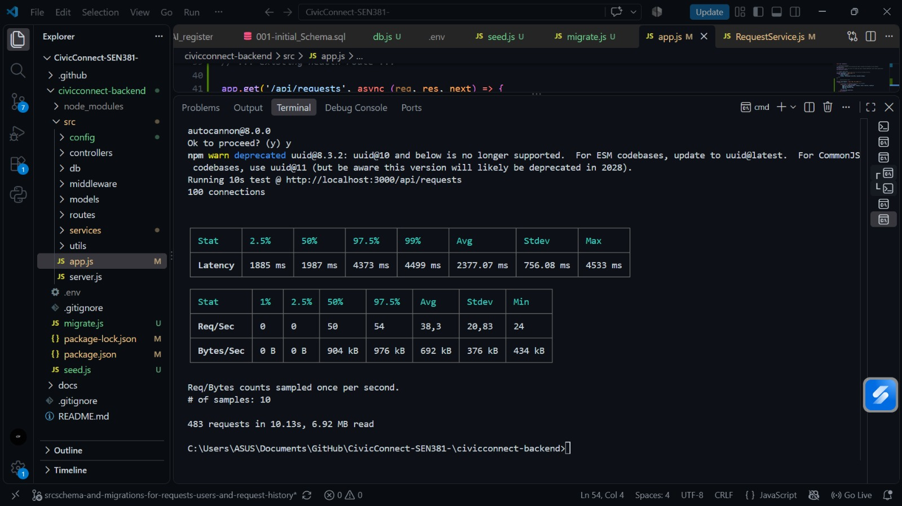

# Milestone 3 Documentation Contributions

## Finalisation defect and release review dated 18 October 2026

Historical defect closures and release logs below remain preserved. The following
new review items concern the inspected backend revision
`93ce4a82a196411ed25b613924c35d32c0cc8619` and require final team disposition.
Missing original features are tracked through the PED scope/RTM, rather than
being silently reclassified as approved scope removals.

| ID | Severity / priority | Observation and consequence | Disposition and verification |
| :--- | :--- | :--- | :--- |
| DEF-FIN-01 | Medium / High for DB evidence | `src/db/seed.js` imports `../src/config/db.js` from inside `src/db`, which resolves to nonexistent `src/src/config/db.js`. The current seed script cannot reproduce its reported run unchanged. | Open; correct the relative import and verify only against a designated test database. No seed execution was performed by this review. Owner: existing persistence portfolio. |
| DEF-FIN-02 | High / High for integrity assurance | `src/db/tc-db.js` uses a dummy actor and treats any exception as passing negative evidence. It does not assert stored history or rollback state. | Open; use valid fixtures, assert expected errors and inspect committed/rolled-back records. Mocked tests support logic but do not repair live evidence. Owner: existing persistence portfolio. |
| DEF-FIN-03 | High / High for evidence accuracy | PED records login/admin PASS results for routes absent from the inspected app; it also overstates API timing as complete browser acceptance. | Open in the Word PED; corrective qualifications supplied in the closure. Identify historical tested revision or remove those results from current acceptance credit. Owner: team documentation review. |
| DEF-FIN-04 | Medium / Medium | README instructs copying `.env.example`, but that file is absent. Fresh setup instructions are incomplete. | Open; supply a secret-free example or document exact variable names and safe configuration steps. Owner: team integration review. |

### Existing risk disposition

| Existing ID | Review result |
| :--- | :--- |
| RSK-M3-01 | Status OCC and conflict cases exist and pass mocked tests. Real assignment concurrency is not implemented and is not covered by this mitigation. |
| RSK-M3-02 | Audit insertion uses the transaction client; rollback on observer failure passes a mocked test. Actual persisted atomicity needs stronger live verification. |
| RSK-M3-03 | Schema/index scripts reduce configuration drift but provide no migration ledger or automatic rollback. Retained rather than closed. |

### Verification and release position

The 18 October rerun of `npm test` passed 42/42 checks. See
`docs/testing-tables/2026-10-18-final-review-verification.md` for group counts
and boundaries. No live database, browser performance or integrated frontend
acceptance was verified during this documentation review.

Local demonstration is planned. The inspected baseline is recommended **no-go
for production** because integrated identity/live acceptance remain unverified,
database certificate verification is disabled, and original ownership/reporting
commitments remain incomplete. Final team adoption and the actual environment
must be stated in the continuing PED. Historical test logs below are not a
blanket approval of the current final build.

## Historical Milestone 3 record


**Portfolio:** Data, Persistence, Risk, and Reliability

---

## Section 8: Defect Register (Milestone 3 Additions)

| Defect ID | Description | Root Cause | Resolution & Mitigation | Status |
| :--- | :--- | :--- | :--- | :--- |
| **DEF-M3-01** | Database migration script failed with authentication error. | Unescaped special characters (e.g., `*`) in the Supabase password broke the connection string parser. | URL-encoded special characters (e.g., replaced `*` with `%2A`) inside the local `.env` file. | Closed |
| **DEF-M3-02** | Server crashed on boot with `ERR_MODULE_NOT_FOUND`. | Inconsistent ES6 module imports and mismatched directory paths after flattening the repository folder structure. | Corrected relative paths and ensured all local module imports explicitly included the `.js` extension. | Closed |
| **DEF-M3-03** | Peer environments failed to execute database scripts due to missing modules. | The `pg` PostgreSQL driver was installed locally but not saved to the project blueprint. | Executed `npm install pg`, updated `package.json` and `package-lock.json`, and pushed to the remote repository. | Closed |

---

## Section 9: Risk Register (Milestone 3 Updates)

| Risk ID | Risk Description | Probability | Impact | Mitigation Strategy |
| :--- | :--- | :--- | :--- | :--- |
| **RSK-M3-01** | **Lost Updates:** Concurrent access by staff members could overwrite status changes on the same ticket. | Medium | High | Implemented Optimistic Concurrency Control (OCC). A `version` integer is checked and incremented during updates; stale versions are rejected. |
| **RSK-M3-02** | **Partial Audit Logs:** Server crashes mid-update could leave a status changed without a corresponding history log. | Low | High | Enforced strict ACID compliance. The status change and `request_history` insertion execute within a single atomic PostgreSQL transaction that rolls back on any failure. |
| **RSK-M3-03** | **Deployment Drift:** The production database schema falls out of sync with the local development environment. | Medium | Medium | Established strict infrastructure-as-code principles via `migrate.js` to ensure the schema is reproducible and version-controlled. |

---

## Section 10: Residual Risk Statement

**M3 Residual Risk:** 
While the persistence layer now guarantees data integrity and atomic state transitions at the database level, a residual risk remains regarding client-side desynchronization. Because the system currently relies on an in-app stub rather than real-time WebSockets for dashboard notifications (deferred per M3 scope), a staff member's browser may display stale data until manually refreshed. If they attempt an update on this stale view, the OCC transaction boundary will correctly block the data loss, but the resulting error may cause user friction. Future milestones will need to address this via automated state invalidation on the frontend.

---

## Release Evidence Summary (Task T2)

### 1. Persistence & Transaction Integrity (ASR-2, FR-002)
*The following execution log verifies that the PostgreSQL schema deployed successfully and that atomic transactions with OCC correctly prevent lost updates and invalid state transitions.*

```text
====== STARTING CIVICCONNECT PERSISTENCE MIDDLEWARE TESTS ======
 ✅ TC-DB-001: PASSED (Valid transition logged, version incremented natively)
 ✅ TC-DB-002: PASSED (Invalid state transition rolled back, no partial data)
 ✅ TC-DB-003: PASSED (Stale OCC update rejected with concurrency conflict)

====== TEST EVIDENCE EXECUTION SUMMARY ======
Total Executed Checkpoints: 3
Total Successful Passes: 3 / 3
[INFO] CRITICAL RELEASE CRITERIA SATISFIED SUCCESSFULLY.
```

### 2. Performance Load Testing (NFR-005)
*The following Autocannon load test verifies that the dashboard list endpoint (`GET /api/requests`) maintains an average latency of under 3 seconds when subjected to 100 concurrent connections across 1,000 seeded database rows.*

```text
====== AUTOCANNON LOAD TEST EVIDENCE ======
```


